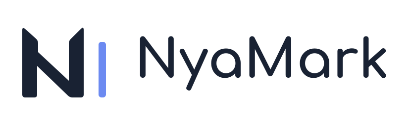

<div align="center">
  <h1 align="center">
    <picture>
      <source media="(prefers-color-scheme: dark)" srcset="src-tauri/icons/banner-dark.svg">
      
    </picture><br>
    NyaMark
  </h1>
  <p align="center">
    一款轻量、快速启动的 Markdown 编辑器，内置 AI 写作助手。打开就写，写完就走。
    <br />
    <br />
    <a href="README.md">简体中文</a>
    |
    <a href="README_EN.md">English</a>
  </p>
</div>

<p align="center">
  <a href="https://nm.lolicon.best/hero-assistant.webp">
    
  </a>
</p>

<details>
  <summary>目录</summary>

* [AI 写作助手](#ai-写作助手)

* [特性](#特性)

* [使用方式](#使用方式)

* [开发调试](#开发调试)

* [开源协议](#开源协议)

* [致谢](#致谢)

</details>

## AI 写作助手

从 1.1 起，文档旁边多了一位 AI 助手。它读得懂正在写的文章，可以起草、改写、校对、查资料；每一处修改都先标在正文里，留不留由你决定。

* **逐处审阅修改**：助手的改动以增删标记直接显示在正文中，每一处都能单独接受或拒绝，接受之后照常撤销。切换到自动模式，修改就直接写入文档。

* **读懂上下文**：助手能读取当前文档的全文、大纲和选中内容，也能查阅和修改同一文件夹里的其他 Markdown 笔记；新建或改动其他文件之前会先征得同意。

* **随手就用**：选中文字，从工具栏一键润色、改写、缩短、扩写、修正语法或翻译；在斜杠菜单里续写、总结上文；打开自动补全后，停笔时光标后会浮现灰色的续写建议，按 Tab 采纳。

* **联网查资料**：免填搜索 API 密钥，助手直接搜索网页、读取页面内容；用 Anthropic 或 OpenAI 时也可以改用服务商自带的联网搜索。

* **图片与 MCP**：截图、照片可以直接发给支持图片的模型；接入 MCP 服务器，为助手扩展更多工具。

* **模型随你选**：OpenAI、Anthropic、Google Gemini、DeepSeek、OpenRouter、通义千问、Kimi、智谱 GLM、硅基流动、火山方舟，Ollama、LM Studio 等本地模型，以及任意 OpenAI 兼容服务；也可以直接登录 ChatGPT（Plus 及以上套餐），用已有的套餐额度。推理模型可调节推理强度。

* **密钥与记录留在本机**：API 密钥存放在系统钥匙串，只发送到你填写的服务地址；每篇文档的对话保存在本机，重新打开文档就能接着聊。

## 特性

* **轻量启动**：基于 <a href="https://tauri.app/"><strong>Tauri v2</strong></a> 和 Rust，启动快、占用轻，打开就能开始写。

* **专注写作**：基于 <a href="https://milkdown.dev/"><strong>Milkdown</strong></a> (Crepe) 的所见即所得体验，编辑过程顺手，不打断思路。

* **常用能力一次配齐**：

  * **数学公式**：内置 KaTeX，渲染 LaTeX 公式。

  * **图表渲染**：集成 Mermaid，支持流程图、时序图、甘特图等多种图表。

  * **GitHub 提示块**：`> [!NOTE]`、`> [!TIP]`、`> [!IMPORTANT]`、`> [!WARNING]`、`> [!CAUTION]` 按 GitHub 的样式显示。

  * **内嵌 HTML**：文档里的 HTML 经过清理后直接渲染，行内标签留在行内。

  * **源码模式**：底层采用 CodeMirror 6，源码与预览分栏显示，滚动同步。

  * **图片与附件**：粘贴、拖入或选择本地图片时，按设置保留原路径、复制到文档旁、`./assets` 或自定义文件夹，也可以嵌入为 Base64。

  * **大纲、查找与 PDF 导出**：大纲跳转标题，查找高亮全部匹配，可导出为 PDF。

* **放心保存**：可开启自动保存；其他程序改动文件时会提醒；保存时保留原文件的 BOM 与换行符。

* **自动更新**：应用内检查、下载并安装新版本。

* **多语言界面**：简体中文、繁體中文、English，默认跟随系统语言。

* **跨平台支持**：原生支持 Windows、macOS 和 Linux。

* **界面克制**：浅色与深色主题跟随系统，可开启毛玻璃效果，重点留给内容。

## 使用方式

前往 [Releases](https://github.com/MliroLirrorsIngenuity/NyaMark/releases) 页面下载**对应平台**的最新版本安装即可使用。

## 开发调试

本项目基于 Bun 和 Tauri 开发：

```bash
# 安装依赖
bun install

# 启动开发环境
bun tauri dev

# 构建生产版本
bun tauri build
```

## 开源协议

除下文所列的图标资源外，本项目遵循 [MIT License](LICENSE) 开源协议。

### 协议注意事项

1. **保留版权声明**：在您分发本项目的副本或基于本项目衍生的软件中，必须包含原作者的版权声明和许可声明。
2. **免责声明**：本项目按“原样”提供，作者不承担任何因使用本项目而产生的法律责任。
3. **图标资源所有权声明 (重要)**：

   * NyaMark 的图标与标志图形（`src-tauri/icons` 目录下的全部文件和 `public/favicon.svg`）**不随 MIT 许可证一同发放**。

   * **上述图标资源保留所有权利 (All Rights Reserved)**，未经原作者明确许可，严禁在其他项目中使用、修改或重新分发这些图标资源。

## 致谢

* [Tauri](https://tauri.app/)：构建跨平台桌面应用的优秀框架

* [Milkdown](https://milkdown.dev/)：模块化的所见即所得 Markdown 编辑器框架

* [CodeMirror](https://codemirror.net/)：业界领先的代码编辑器组件
